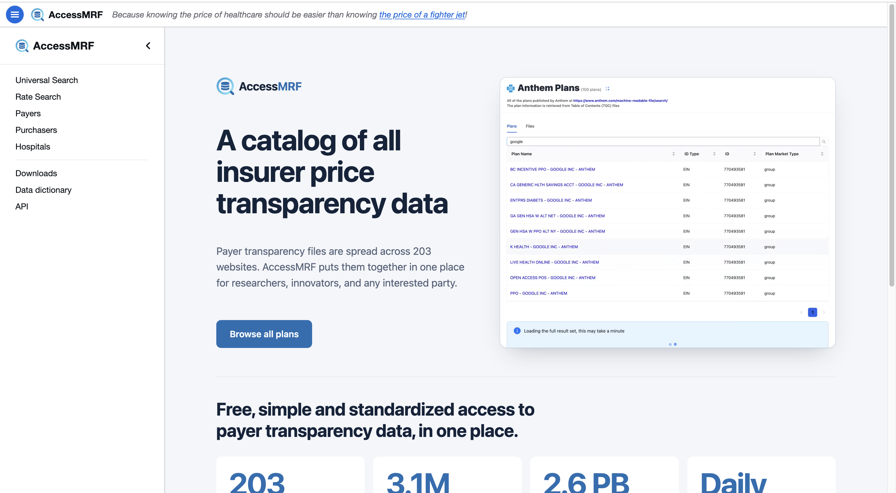
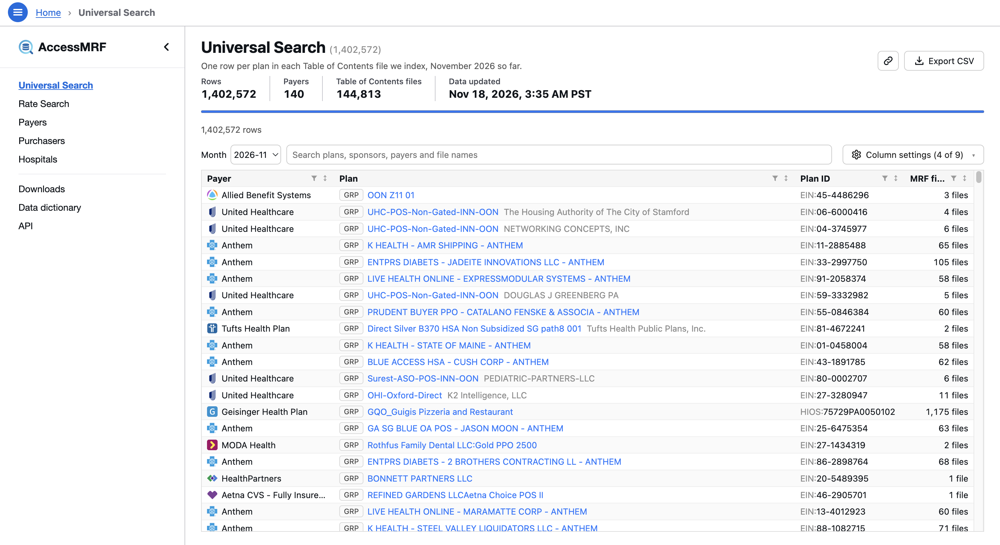
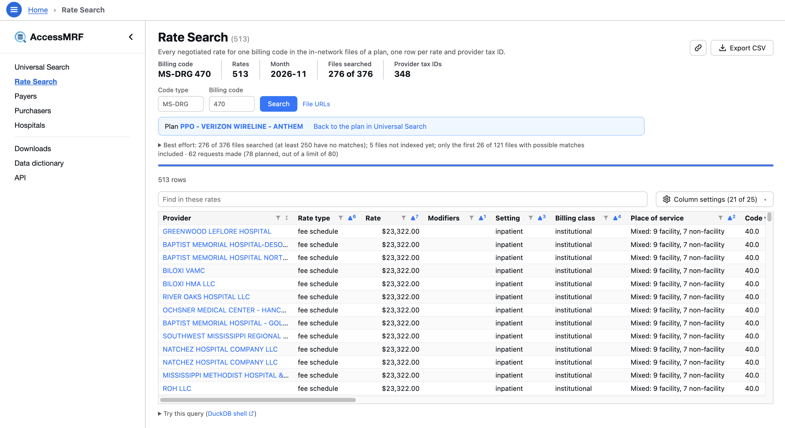
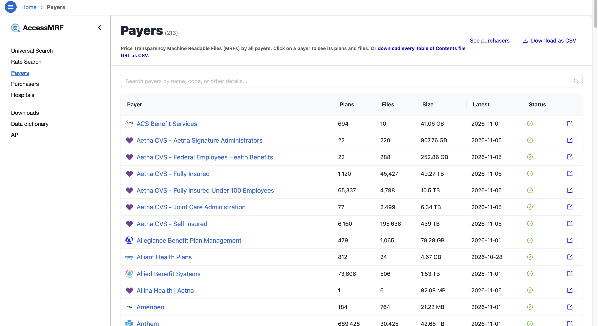
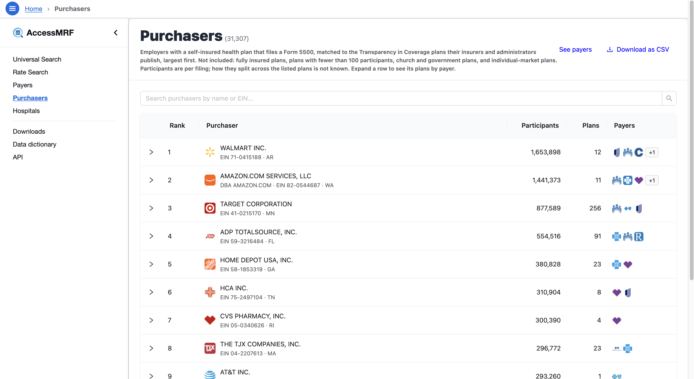
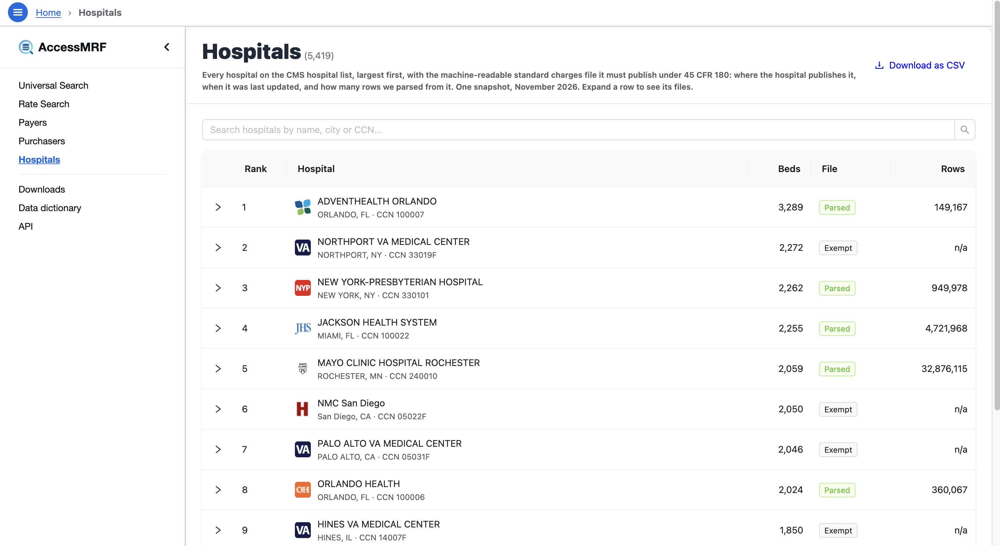

> I'm using DuckDB to make accessing healthcare pricing data much easier. The key advantage of using DuckDB is that I can serve 10 terabytes of data in the browser almost instantly and at no marginal cost.
>
> — Felix Haba, creator of AccessMRF
{: .quote-large}

[Felix Haba](https://www.felixhaba.com/) is an engineer based in San Francisco with a long-standing passion for healthcare economics. He started [AccessMRF](https://www.accessmrf.com/) as a metadata catalog to help researchers, consultants, and employers locate and access the US government's [Transparency in Coverage](https://www.cms.gov/newsroom/fact-sheets-transparency-coverage-final-rules-cms-9882-f) (TiC) healthcare pricing data. Recently, he evolved the project by adding [DuckDB-Wasm]() and [Frozen DuckLake](https://duckdb.org/2025/10/24/frozen-ducklake) to enable browser-based queries over 10 TB of healthcare pricing data—without requiring expensive server-side analytical infrastructure.

The homepage shows the scope of data now accessible in one searchable catalog.

  

<a href="https://www.accessmrf.com" target="_blank" style="text-decoration: none;">AccessMRF homepage: A catalog of all insurer price transparency data</a>

## The Problem: Mandated But Inaccessible Data

Under federal law, US health insurers must publish machine-readable price data, but the mandate did not create an accessible resource. The result is thousands of large files scattered across roughly 200 different insurer websites, each in its own location.

The format itself is problematic. Source files are compressed JSON archives—typically 3 GB compressed and expanding to 350 GB or more when uncompressed—and JSON is not streamable. Processing these files requires either downloading massive amounts of data locally or running expensive server-side queries. Most analysis has been gated behind commercial licensed platforms that make the data usable but add a paywall, excluding independent researchers, smaller employers, and consultants from accessing the information.

Felix explains: **"The biggest problem is finding the data and the websites where it is published. It's still a big JSON file that's not streamable. The data is there, but it's a little bit hard to work with. Unless you make it easier to work with."**

## Building AccessMRF: From Discovery to Query

Felix's initial approach was straightforward: create a metadata catalog where interested researchers could find which insurers publish TiC data and where to retrieve it. This helped his primary audience—**benefits consultants, self-funded employers, healthcare economics researchers, and providers**—discover the source files.

But discovery alone was not enough. Downloading and processing the raw files still required significant infrastructure. He wanted to take the next step: make the data query-friendly and accessible directly in a browser.

The Universal Search interface enables exploring over 1.4 million individual pricing plans across all insurers.

  

<a href="https://www.accessmrf.com?category=Universal%20Search" target="_blank" style="text-decoration: none;">AccessMRF Universal Search showing 1.4M+ indexed plans and files</a>

He encountered [Mark Harrison's](https://duckdb.org/2025/10/24/frozen-ducklake) work on Frozen DuckLake at the Data Outpost conference, which introduced him to Gábor Szárnyas. Together, they explored how a Frozen DuckLake could serve as a solution.

## From JSON to Browser-Queryable Data

The pipeline Felix built operates like this:

1. **Discover and index:** AccessMRF's metadata catalog identifies where each insurer publishes TiC files.
2. **Convert:** Raw JSON is transformed into [Parquet](https://parquet.apache.org/) files, organized for efficient queries on specific keys—enabling fast retrieval by date, price, provider, and other attributes.
3. **Build:** A Frozen DuckLake catalog is assembled using the **S3 API** rather than HTTPS. S3 provides faster file traversal, which is critical when packing ~150,000 Parquet files into the catalog. **The build takes about 30 minutes.**
4. **Publish:** Once built, the DuckLake's root path is repointed to HTTPS, making the catalog publicly accessible. Because the Frozen DuckLake uses relative paths, this transition is seamless; the data remains in object storage but is now served over HTTPS.
5. **Query:** [DuckDB-Wasm]() runs entirely in the user's browser, executing SQL directly against the published Frozen DuckLake. Only the data necessary to answer each query is fetched from storage.

  

<a href="https://www.accessmrf.com?category=Rate%20Search" target="_blank" style="text-decoration: none;">AccessMRF Rate Search: Querying negotiated rates by billing code</a>

This architecture eliminates the need for a managed analytical database, which would require login credentials, a paywall, or per-query charges that would be prohibitively expensive at the scale of public access.

## The Economics of Shifting Compute to the Client

Felix highlights the cost advantage: **"I don't care how many queries I get. I do have some rate limits, but generally I don't care how many queries I get so long as the users are well-intentioned. I will not see a huge bill for serving this dataset. I just pay the fixed cost of hosting the storage."**

Server-side alternatives like [BigQuery](https://cloud.google.com/bigquery) would have required metered billing that scales with query volume. At public scale, that would necessitate a paywall or login system incompatible with Felix's goal of free, open access.

By contrast, DuckDB-Wasm shifts the computation to each user's device. **"The compute is moved to the edge,"** Felix says, describing how this changes the cost equation entirely.

## Trade-offs and Current Limitations

The Frozen DuckLake model introduces one significant trade-off: **data staleness**. Felix uses a cron job to rebuild the Frozen DuckLake daily, creating a lag between when new insurer files are published and when they become queryable in AccessMRF.

**"I have a cron job that runs every day, makes a new frozen DuckLake,"** Felix explains. **"There's a staleness problem with the frozen DuckLake. The data is somewhat stale. But I think it's a fair trade-off for me."** For most use cases—validating claims, benchmarking rates, publishing research—daily snapshots are sufficient.

## Who Benefits and What Comes Next

AccessMRF's users today include researchers who use the metadata index to locate source files. A real-world example is a startup analyzing claims for self-funded employers; they discovered AccessMRF and used it to identify relevant insurer URLs. Felix is aware of researchers preparing to publish analysis using the data in *Health Affairs Forefront*.

  

<a href="https://www.accessmrf.com?category=Payers" target="_blank" style="text-decoration: none;">AccessMRF Payers: 213 health insurers indexed with their pricing plans</a>

  

<a href="https://www.accessmrf.com?category=Purchasers" target="_blank" style="text-decoration: none;">AccessMRF Purchasers: Self-insured employers like Walmart and Amazon with their healthcare plans</a>

Felix sees the DuckDB-Wasm component as still early. **"I don't think they've used the DuckDB component yet because I've released that really recently."** But the foundation is in place for script-savvy experts to perform complex analysis without building a data engineering pipeline.

His longer-term vision extends beyond current use cases: **"I hope that this will improve the quality of the data in the long term, and we'll be able to build a healthcare marketplace using this data or make other cool technologies derived from this price transparency data."** He also points to the human impact: **"Price uncertainty makes people afraid of going to the doctor. If you add financial uncertainty to that, it's a barrier for patients to get healthcare soon and early. By making price data available, I hope that people will be less worried about going to the doctor."**

  

<a href="https://www.accessmrf.com?category=Hospitals" target="_blank" style="text-decoration: none;">AccessMRF Hospitals: 5,419 CMS-regulated hospitals with their published charges</a>

## Bringing It Together

AccessMRF demonstrates how DuckDB's browser-based engine can transform how public data is accessed. By treating the browser as a first-class analytical environment and combining it with Frozen DuckLake for efficient snapshots, Felix has made 10 TB of healthcare pricing data queryable without the cost overhead that would normally require a business model incompatible with public access.

The barriers to entry for researchers, consultants, and innovators are no longer financial or infrastructural. What remains is for more experts to discover the resource and build insights that improve healthcare pricing transparency.

## Try It

You can explore AccessMRF's data at [accessmrf.com](https://www.accessmrf.com). If you are a healthcare consultant, researcher, analyst, or policy maker, try running a query over the pricing dataset. The data is public, and the barrier to access is gone.

## Further Reading

* [AccessMRF](https://www.accessmrf.com)
* [Felix Haba's research on healthcare price transparency](https://www.felixhaba.com/writing/simplifying-healthcare-price-transparency-files-with-minhashing/)
* [Frozen DuckLakes for Multi-User, Serverless Data Access](https://duckdb.org/2025/10/24/frozen-ducklake)
* [DuckDB-Wasm documentation]()
* [Transparency in Coverage final rules](https://www.cms.gov/newsroom/fact-sheets-transparency-coverage-final-rules-cms-9882-f)

We would like to thank Felix for the conversation. If you are using DuckDB and would like to share your story, reach out to us at [geertjan@ducklabs.com](mailto:geertjan@ducklabs.com).
