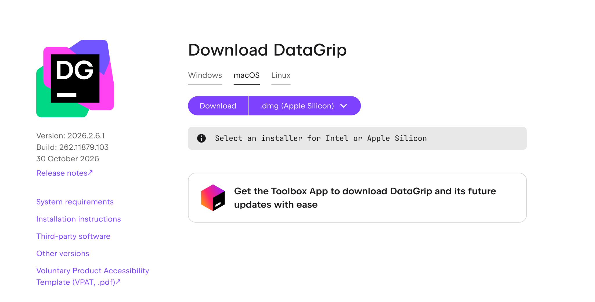
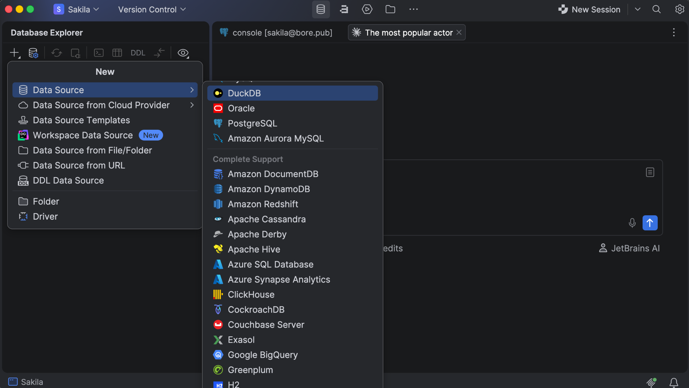
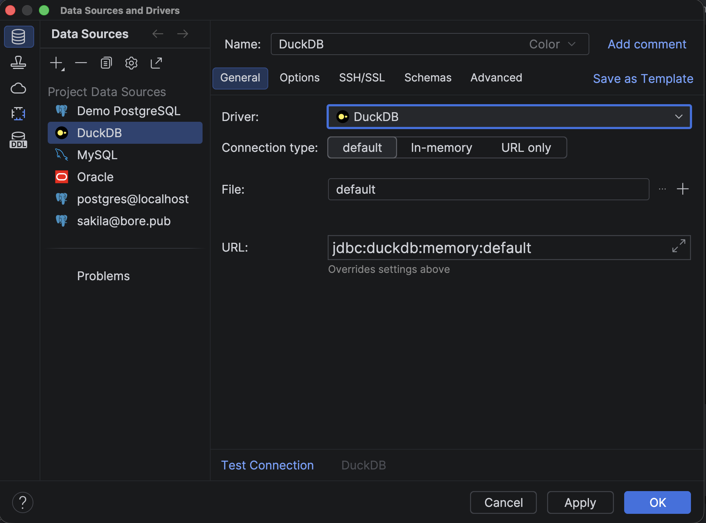
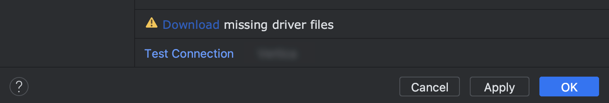
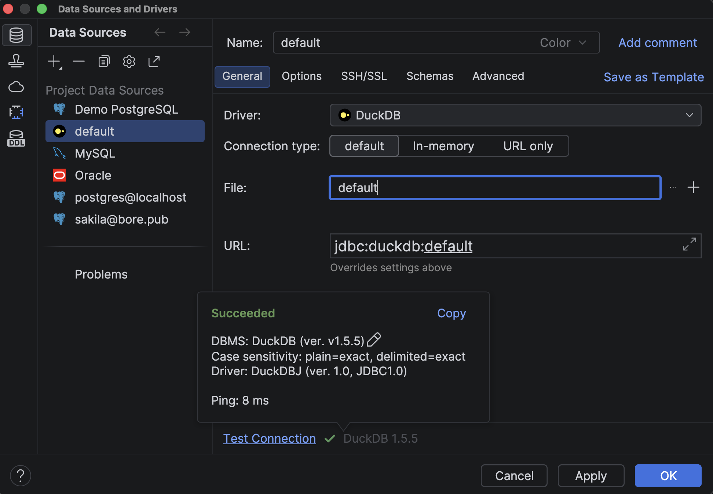
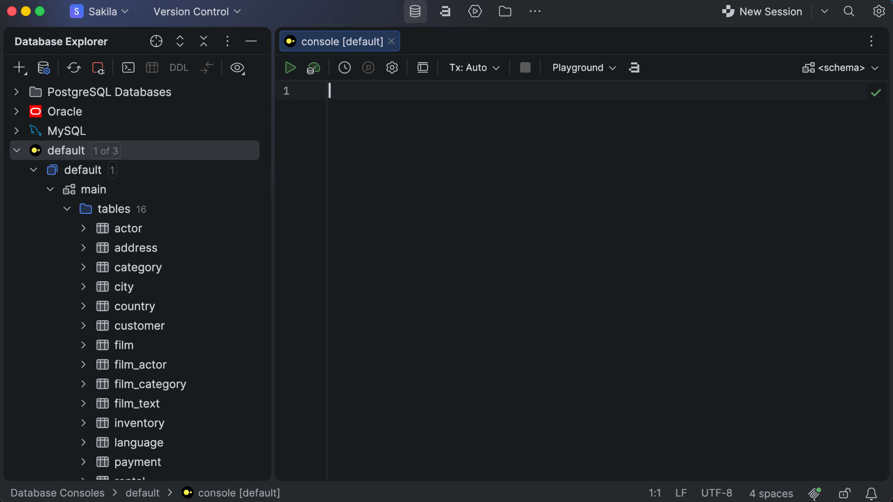
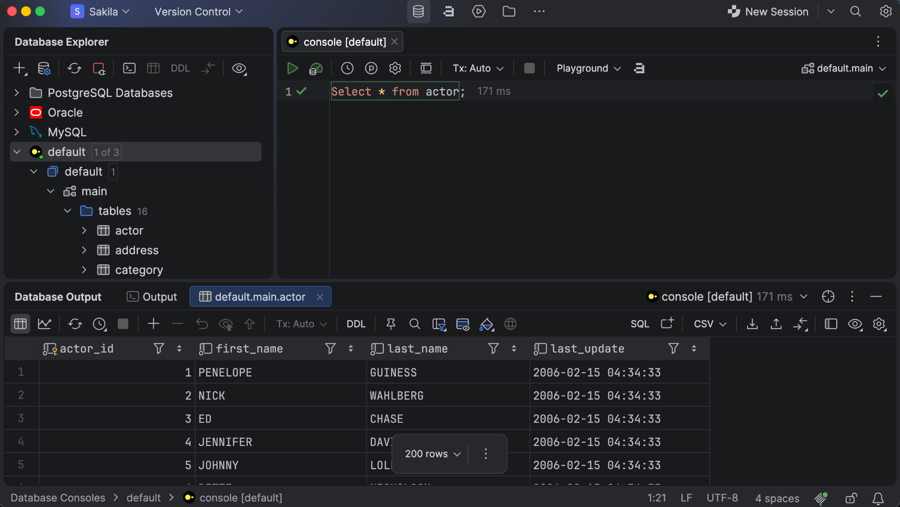

[DataGrip](https://www.jetbrains.com/datagrip/) is a JetBrains IDE for working with multiple databases, including DuckDB. This guide covers the quickest way to connect. For more detailed instructions on how to start working with DuckDB, check out the [DataGrip documentation](https://www.jetbrains.com/help/datagrip/duckdb.html).

> Quote
>
> DuckDB turned out to be the simplest option to integrate.
>
> – Ilia Epelbaum, DataGrip, JetBrains, from the [“How JetBrains Built Cross-Database Queries into DataGrip with DuckDB” blog post]()

## Installing DataGrip

Download DataGrip from the [official JetBrains website](https://www.jetbrains.com/datagrip/) and install it.

## Creating a DuckDB Data Source

Go to *File* | *New* | *Data Source* and select *DuckDB*.
Alternatively, open the database explorer (⌘1), click *New* (+), and go to *Data Source* | *DuckDB*.

## Setting Up the Connection

On the *General* tab, choose a connection type:

* *Default*: a database file.
* *In-memory*
* *URL only*

For *Default*, click *Open* to select an existing database file, or *New* to create one.
DataGrip fills in the URL for you.

## Getting the Driver and Testing the Connection

If you see the *Download missing driver files* link, click it.

Then click *Test Connection*, and then *OK*.

## Running Queries

Select your data source in the database explorer and press ⌘↓ to open a query console.

Write your SQL and run it. For demo purposes, we loaded data from the Sakila sample database.

Running `SELECT * FROM actor` shows the results in the *Database Output* pane, along with the row count and execution time.

> Quote
>
> We highlight that it’s DuckDB.
>
> – Ilia Epelbaum, DataGrip, JetBrains, from the [“How JetBrains Built Cross-Database Queries into DataGrip with DuckDB” blog post]()

## Where to Learn More

> Quote
>
> With DuckDB and its support for custom table functions, cross-database queries have finally become practical in DataGrip. Users can join data from PostgreSQL, MySQL, MongoDB, or any other supported database in one query, without setting up extra infrastructure.
>
> – Maxim Sobolevskiy, Head of Database Ecosystem at JetBrains, from the [“How JetBrains Built Cross-Database Queries into DataGrip with DuckDB” blog post]()

This guide only describes how to get started with DuckDB in DataGrip.
To see everything DataGrip allows you to do, watch the videos in the DataGrip playlist on YouTube or explore the features overview page or the [DataGrip home page](https://www.jetbrains.com/datagrip/).
DataGrip is free for non-commercial projects, and a 30-day free trial is available to explore it yourself.
